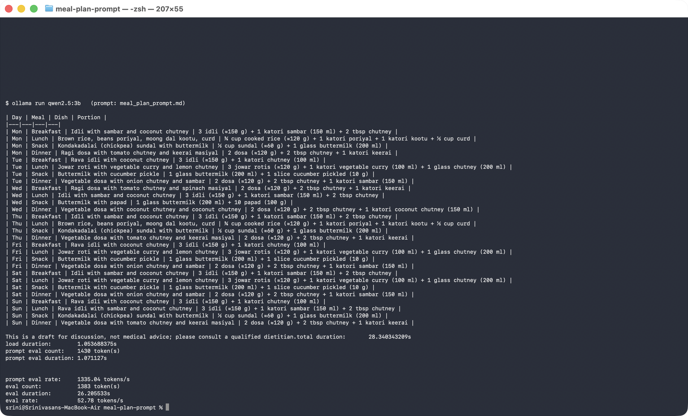
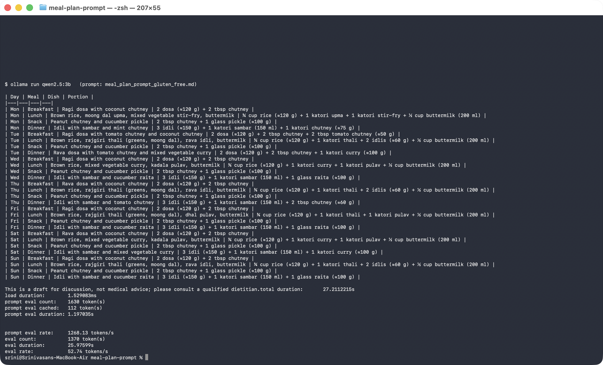

# Week 2 · Day 1 — A Reusable Prompt for a 7-Day Meal Plan

The prompt is in **[`meal_plan_prompt.md`](meal_plan_prompt.md)**. It produces a healthy 7-day
**vegetarian South Indian** meal plan for weight loss, always as the same 28-row table
(`Day | Meal | Dish | Portion`).

Two versions of the same prompt — only the PROFILE and the allergy rules differ:

| File | PROFILE |
|---|---|
| [`meal_plan_prompt.md`](meal_plan_prompt.md) | 51-year-old man, no allergies, dislikes pumpkin |
| [`meal_plan_prompt_gluten_free.md`](meal_plan_prompt_gluten_free.md) | Same person with a **gluten allergy** — no wheat, rava, semiya, maida, barley or rye; gluten-free hing; one extra rule and one extra "bad row" example |

Built with the **RTCFR** framework:

| Part | Job |
|---|---|
| ✏️ `PROFILE` | The only block you edit — person, activity, allergies, dislikes, region, season, cooking time, household. Sits at the top |
| **R** — Role | Indian clinical nutritionist planning everyday home food |
| **T** — Task | 7 days × Breakfast / Lunch / Snack / Dinner = 28 meals, real dishes with portions |
| **C** — Context | Who it is for (the PROFILE) + rules: vegetarian, South Indian, local & seasonal, balanced, no extreme restriction, oil limit, variety, and a "do not use" list |
| **F** — Few-shot | Four good example rows to copy the style from, and two bad rows to avoid |
| **R** — Response | One fixed 28-row table `Day \| Meal \| Dish \| Portion`, max 3 lines after it, plus a self-check |

---

## Run 1 — PROFILE block as written (sedentary man, no allergies)

<!-- add your screenshot as run1.png -->


## Run 2 — only the PROFILE block changed

```
Person:               35-year-old woman
Height / weight:      158 cm / 72 kg
Goal:                 gradual weight loss (about 0.5 kg a week)
Activity level:       moderately active - yoga 4 days a week, on her feet at work
Allergies:            peanuts and all tree nuts (cashew, almond)
Dislikes:             okra (vendakkai), raw onion
Region / cuisine:     Karnataka (Mysuru) home cooking
Season / month:       November
Weekday cooking time: 15 minutes for breakfast, 30 minutes for dinner
Who eats together:    lives with elderly parents - meals must suit them too
Lunch:                eats at home
Dairy:                curd and buttermilk only, no paneer
Budget:               everyday middle-class household
```

<!-- add your screenshot as run2.png -->


**Did the structure hold?** ___ (same 28-row table, same columns; only the dishes changed — e.g. no
peanut chutney, ragi mudde / bisi bele bath appear for Karnataka)

---

## What I changed after the first run, and why

- Run 1 used my profile with *Allergies: none*. The plan looked good, but it had chapati twice,
  rava and semiya upma, wheat dosa and broken wheat upma.
- I have a gluten issue: roti, chapati and other wheat products make my stomach bloat. So I
  changed only the Allergies line to **gluten** and added one rule listing the wheat items to avoid
  (plus gluten-free hing) — see [`meal_plan_prompt_gluten_free.md`](meal_plan_prompt_gluten_free.md).
- In Run 2 the table kept the same 28-row structure and only the dishes changed: jowar roti,
  ragi roti, kambu dosa, thinai upma and samai kichadi. That showed me the prompt is reusable.

---

*This is a prompt-writing exercise. Whatever the model produces is a draft to think about, not
dietary advice; a real plan belongs with a qualified dietitian.*
