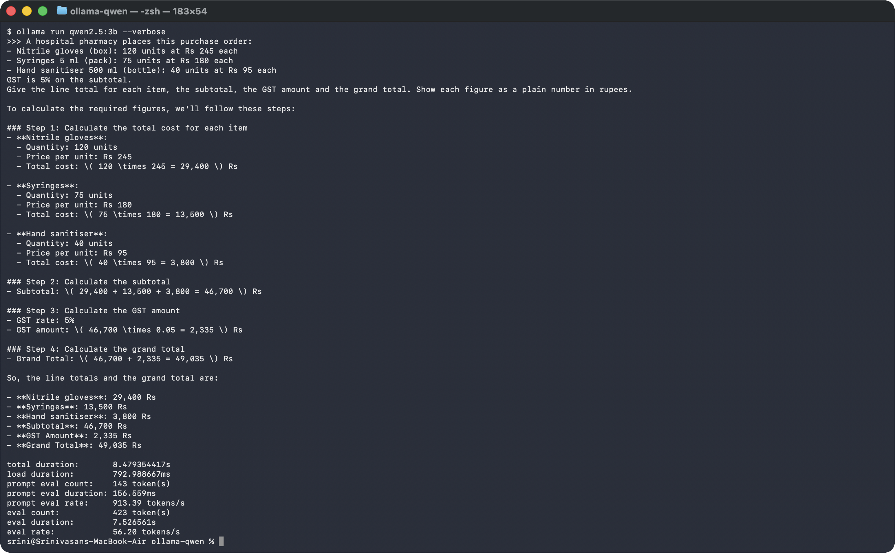

# Week 1 · Day 5 — Qwen 2.5 running locally with Ollama

**Model used:** qwen2.5:3b (≈1.9 GB download)
**Machine:** MacBook Air (Apple silicon)

## Prompt (checkable answer)

```
A hospital pharmacy places this purchase order:
- Nitrile gloves (box): 120 units at Rs 245 each
- Syringes 5 ml (pack): 75 units at Rs 180 each
- Hand sanitiser 500 ml (bottle): 40 units at Rs 95 each
GST is 5% on the subtotal.
Give the line total for each item, the subtotal, the GST amount and the grand total.
Show each figure as a plain number in rupees.
```

## Correct answer (worked out by hand and in Python)

| Line | Working | Amount (₹) |
|---|---|---|
| Gloves | 120 × 245 | 29,400 |
| Syringes | 75 × 180 | 13,500 |
| Sanitiser | 40 × 95 | 3,800 |
| Subtotal | | 46,700 |
| GST 5% | 46,700 × 0.05 | 2,335 |
| **Grand total** | | **49,035** |

## Results (qwen2.5:3b, 9 Nov 2026)

| Run | Reply time | Figures correct | Notes |
|---|---|---|---|
| 1 | 9.5 s | 6 / 6 | Subtotal 46,700 · GST 2,335 · Total 49,035 |
| 2 | 8.5 s | 6 / 6 | Same figures, different wording and layout |

**Earlier run with GST at 12% (same model, same day):** run 1 was 6/6 in 7.8 s, but run 2 (9.5 s)
added the three correct line totals wrongly (29,400 + 13,500 + 3,800 = "56,900" instead of 46,700),
so the subtotal, GST and grand total were all wrong — 3/6. Same prompt, different answer.

## How I verified it

I picked a calculation so the answer is either right or wrong. I worked out every figure by hand,
then `ollama_check.py` recalculated them in Python and checked each number in the model's reply.
I ran the same prompt twice to see whether the answer changed.


