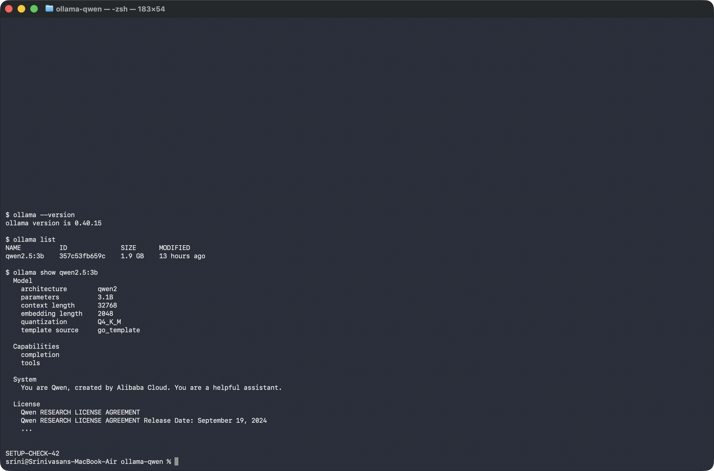

# Week 1 · Day 5 — Run Qwen 2.5 locally with Ollama

Qwen 2.5 running on my own MacBook Air through Ollama: no API key, no internet once the
model is downloaded, no cost per word. I gave it a task with a checkable answer and verified it.

**Model:** `qwen2.5:3b` (≈1.9 GB) **Machine:** MacBook Air, Apple silicon, macOS

---

## 1. Setup (macOS)

```bash
# Step 1 – install Ollama
#   macOS: download the app from https://ollama.com/download, move it to Applications, open it once
#   (the PDF's  curl -fsSL https://ollama.com/install.sh | sh  is the Linux installer)
ollama --version                 # confirms Ollama is installed and running

# Step 2 – pull Qwen 2.5 at a size this laptop can handle
ollama pull qwen2.5:3b           # the 3B model, ~1.9 GB
ollama list                      # confirms the model is there, and its size
ollama show qwen2.5:3b           # parameters, quantisation, context length

# Step 3 – prompt it (verbose prints the timing)
ollama run qwen2.5:3b --verbose
```

Proof from my Mac — output of the commands above: [`setup_log.txt`](setup_log.txt)



---

## 2. The prompt (checkable answer)

```
A hospital pharmacy places this purchase order:
- Nitrile gloves (box): 120 units at Rs 245 each
- Syringes 5 ml (pack): 75 units at Rs 180 each
- Hand sanitiser 500 ml (bottle): 40 units at Rs 95 each
GST is 5% on the subtotal.
Give the line total for each item, the subtotal, the GST amount and the grand total.
Show each figure as a plain number in rupees.
```

### Ollama session — prompt and answer


---

## 3. Verification

Correct answer, worked out by hand and recalculated in Python (`ollama_check.py`):

| Line | Working | Amount (₹) |
|---|---|---|
| Gloves | 120 × 245 | 29,400 |
| Syringes | 75 × 180 | 13,500 |
| Sanitiser | 40 × 95 | 3,800 |
| Subtotal | | 46,700 |
| GST 5% | 46,700 × 0.05 | 2,335 |
| **Grand total** | | **49,035** |

### Results — same prompt, run twice (qwen2.5:3b)

| Run | Reply time | Figures correct | Notes |
|---|---|---|---|
| 1 | 9.5 s | 6 / 6 | Subtotal 46,700 · GST 2,335 · Total 49,035 |
| 2 | 8.5 s | 6 / 6 | Same figures, different wording and layout |
| Terminal session (screenshot) | 8.5 s | 6 / 6 | 423 tokens at 56 tokens/s, model load 0.8 s |

Full model answers: [`results_qwen2.5-3b_2026-11-09.md`](results_qwen2.5-3b_2026-11-09.md)

**Earlier run with GST at 12% (same model, same day):** run 1 was 6/6 in 7.8 s, but run 2 (9.5 s)
added three correct line totals wrongly (29,400 + 13,500 + 3,800 = "56,900" instead of 46,700),
so the subtotal, GST and grand total were all wrong — 3/6. Same prompt, different answer.

**How I verified it:** I chose a calculation so the answer is plainly right or wrong. I worked out
each figure by hand, then `ollama_check.py` sent the prompt to the local Ollama API twice, timed
each reply and checked every number in the answer against the Python calculation.

**Size trade-off:** the 3B model fits comfortably on a laptop and replies in under 10 seconds,
but it was not consistent — one of my five runs made an addition mistake. For anything involving
money I would verify its output, or try the larger default `qwen2.5` (7B), which is slower.

---

## Files

| File | What it does |
|---|---|
| `ollama_check.py` | Sends the prompt to the local Ollama API (`localhost:11434`) twice, times each reply, checks all 6 figures, saves the results file |
| `setup_proof.py` | Runs `ollama --version`, `ollama list`, `ollama show` and saves `setup_log.txt` + `ollama_setup.png` |
| `take_ollama_screenshot.py` | Runs `ollama run qwen2.5:3b --verbose` with the prompt in Terminal and saves `ollama_session.png` |
| `results_qwen2.5-3b_2026-11-09.md` | Both model answers with times and scores |

Run the check yourself (Ollama running, model pulled):

```bash
python3 ollama_check.py qwen2.5:3b
```
